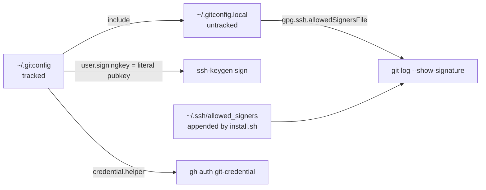

# Architecture overview

## What this is

The repository stores configuration files for zsh, PowerShell, Starship, Git, and the Claude Code, Codex and Cursor CLI agents. It has no build step or package manager. [`install.sh`](../../install.sh) wraps the macOS `ln -sfn` commands and merges the two agent configs that their apps also write, while the [Windows setup](../guides/windows-setup.md) uses `Copy-Item`. [Getting started](../getting-started.md) documents the macOS setup.

## Layout

```
shell/
  .zshrc                              → ~/.zshrc                (macOS)
  .zprofile                           → ~/.zprofile             (macOS)
  starship.toml                       → ~/.config/starship.toml (both)
  Microsoft.PowerShell_profile.ps1    → $PROFILE                (Windows)
git/
  .gitconfig                          → ~/.gitconfig            (both)
  .gitconfig.windows                  → ~/.gitconfig.local      (Windows)
  .gitignore_global                   → ~/.gitignore_global     (both)
ssh/
  config                              → ~/.ssh/config           (macOS)
agents/
  AGENTS.md                           → ~/.claude/CLAUDE.md     (macOS)
                                      → ~/.codex/AGENTS.md      (macOS)
claude/
  settings.json                       → ~/.claude/settings.json (macOS)
  pstack-models.md                    → ~/.claude/pstack-models.md (macOS)
  cloud-setup.sh                      Claude Code cloud setup script, not a dotfile
codex/
  config.toml                         merged into ~/.codex/config.toml (macOS)
cursor/
  cli-config.json                     merged into ~/.cursor/cli-config.json (macOS)
tests/                                checks for install.sh, .zshrc and the docs, not dotfiles
AGENTS.md                             guidelines for agents working in this repo, not a dotfile
```

## Design decisions

**Symlinks on macOS, copies on Windows.** `git pull` updates symlinked files. Windows symlinks need elevated privileges or Developer Mode, so the docs use copies there. There is no dotfile manager: each file has one target, so a manager would add a dependency without saving any setup work.

**Linked and merged agent config.** The Claude Code files hold no host state, so `install.sh` links them like the shell files. The Codex app and the Cursor CLI write host paths and their own state into their configs, so `install.sh` merges the keys and tables the repo names into the live file and keeps the rest. TOML is merged by table in `awk`, because the Command Line Tools Python 3.9 has no `tomllib`. JSON is merged by top-level key with `jq`.

**Tracked configuration with local overrides.** Both `.zshrc` and `.gitconfig` load an untracked local file. Secrets, absolute paths, and host-specific keys such as `allowedSignersFile` and Windows `ssh.exe` paths go in `~/.zshrc.local` or `~/.gitconfig.local`. On macOS `install.sh` seeds `allowedSignersFile` there when it is unset, and never changes a value already set. The tracked file stays identical on every machine. `.gitconfig` stores the signing key as a literal public key for the same reason.

**One instructions file for every agent.** `agents/AGENTS.md` is the only copy of the global agent instructions. `install.sh` links it to the global path each agent reads, `~/.claude/CLAUDE.md` for Claude Code and `~/.codex/AGENTS.md` for Codex. The repo holds no symlink of its own, because a Windows checkout turns one into a text file.

**Optional dependencies.** `.zshrc` checks for optional tools before it runs their setup code, and it checks for plugin files with `[ -f … ]`. The shell works on macOS without those tools. It exports the `FZF_*_COMMAND` variables only when `fd` exists because empty values disable the fzf widgets.

**Startup time.** `compinit` performs its security check, and looks for new completion functions, at most once a day. The completion dump is then compiled with `zcompile`, which cut startup by about a quarter (12 ms) in a Linux benchmark. The default Node version goes on `PATH` directly, and a wrapper function loads nvm itself on first use, which saves about 0.5 seconds per shell start. Homebrew's `shellenv` command runs from `.zprofile` once per login instead of from `.zshrc` for every interactive shell.

**Load order.** Plugins wrap ZLE widgets, so they load after `compinit`, fzf, and zoxide. Autosuggestions load before syntax highlighting, and Starship loads last. `~/.zshrc.local` loads before the plugins.

**Starship without a Nerd Font.** `starship.toml` is Starship's "plain-text-symbols" preset, pinned at `tests/fixtures/starship-plain-text-symbols.toml`, so the prompt renders with any monospace font. Below a marker line it adds text symbols for the `claude_cost` and `claude_model` modules, which the preset does not cover and which default to emoji. `tests/starship_test.sh` rejects any other change.

**Global Git ignore rules.** The global ignore file lists only operating system and editor files. Each project excludes its own build artifacts and logs, which prevents the global file from hiding tracked files such as `*.sql` migrations.

**Signing setup without the private key.** `install.sh` appends the signer line built from `git/.gitconfig` to `~/.ssh/allowed_signers` instead of linking that file, because it also holds lines the repo does not track. It never creates or fetches a key; it prints a notice when `~/.ssh/id_ed25519_git` is missing.

## Git identity and signing flow


